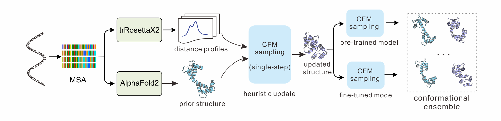

<h1 align="center">trFlow: ultrafast all-atom protein conformational ensemble generation via conditional flow matching</h1>

<p align="center">
  <a href="https://www.python.org/"></a>
  <a href="https://pytorch.org/"></a>
  <a href="LICENSE"></a>
</p>

<p align="center">
  <a href="https://colab.research.google.com/github/YangLab-SDU/trFlow/blob/main/trFlow.ipynb"></a>&nbsp;&larr; <em>Online inference</em>
</p>

<p align="center">
  
</p>

## Overview

trFlow generates all-atom protein conformational ensembles from an A3M
multiple-sequence alignment (MSA). Provide an alignment and, optionally, a
starting PDB structure; otherwise, trFlow predicts the starting structure with
OpenFold. The generated conformations are saved as PDB files.

## Hardware requirements

The local installation below uses **Linux**, **Python 3.11**, and an
**NVIDIA GPU** with CUDA-enabled PyTorch.

To run trFlow without installing it locally, open the
[Google Colab notebook](https://colab.research.google.com/github/YangLab-SDU/trFlow/blob/main/trFlow.ipynb).
Select a **GPU** runtime and follow the notebook's steps.
Run Step 1 to install the environment and model files, then run Step 2 to show
the input panel. Paste a sequence, upload one FASTA, or use an existing A3M;
upload controls appear after you run the cell. Sequence/FASTA inputs can generate
an MSA after you confirm use of the public ColabFold service. Advanced MSA options
are collapsed by default. Model files and MSAs use temporary runtime storage,
not your Google Drive.

## Installation

### Step 1: Clone the repository

```bash
git clone https://github.com/YangLab-SDU/trFlow.git
cd trFlow
```

### Step 2: Create and activate the trflow environment

Use [Conda](https://www.anaconda.com/docs/getting-started/miniconda/install) to
create the `trflow` environment with PyTorch 2.6.0 and CUDA 11.8:

```bash
conda env create -f environment.yml
conda activate trflow
python -m pip install -e . --no-deps
cp -n config/env_config.json.template config/env_config.json
```

If [Mamba](https://mamba.readthedocs.io/en/latest/installation/mamba-installation.html)
is installed, use `mamba env create -f environment.yml` for the first command.

### Step 3: Download model weights

Download and extract the pretrained model weights into `models/`:

```bash
mkdir -p models
wget http://yanglab.qd.sdu.edu.cn/trFlow/pretrained_models.tar.bz2
tar -xjf pretrained_models.tar.bz2 -C models
```

The archive contains:

| File | Description |
| --- | --- |
| `trflow_xray.pth` | trFlow Xray checkpoint |
| `trflow_nmr.pth` | trFlow NMR checkpoint |
| `esm_msa1_t12_100M_UR50S.pt` | ESM-MSA-1b weights |
| `openfold_params_model_5_ptm.npz` | OpenFold `model_5_ptm` parameters |

### Step 4: Configure and check the GPU

The default settings in `config/env_config.json` use the model files in
`models/` and GPU 0 (`"gpus": [0]`). Edit this file if you use another GPU or
store the weights elsewhere. If OpenFold is installed in a separate
environment, set `openfold.python` to that environment's Python executable.

Check that PyTorch can access your GPU:

```bash
python -c "import torch; print(torch.__version__); print('CUDA available:', torch.cuda.is_available())"
```

Make sure the check reports `CUDA available: True` before starting prediction.

## Usage

Run the commands below from the repository root with the `trflow` environment
activated. Use an A3M alignment directly, or a JSON configuration for
single-target and batch runs.

```text
trFlow predict INPUT [OPTIONS]
```

### Quick start: predict from an A3M alignment

Generate 10 conformations from the supplied example alignment:

```bash
trFlow predict example/msa/2akl.a3m \
  --output-dir outputs \
  --models Xray,NMR --sample-num 10
```

The first A3M record must be the ungapped target sequence. Replace the example
path with your own alignment. By default, trFlow generates 200 conformations
per target; use `--sample-num` to choose a different ensemble size.

### Other input options

#### Start from an existing PDB

Supply a starting structure to skip OpenFold initialization:

```bash
trFlow predict alignment.a3m --init-pdb initial.pdb --output-dir outputs
```

#### Check the target sequence against a FASTA file

Add `--fasta` to check that the target sequence in the A3M matches your FASTA:

```bash
trFlow predict example/msa/8CRJ_8CRI.a3m \
  --fasta example/fasta/8CRJ_8CRI.fasta --output-dir outputs
```

#### Use FASTA as the main input

Provide its A3M alignment with `--msa`:

```bash
trFlow predict sequence.fasta --msa alignment.a3m --output-dir outputs
```

### Run from a JSON configuration

Use JSON to save your settings or process several targets in one run. The
supplied examples run the complete pipeline and generate 10 conformations
per target.

#### Single-target example

Run the `8CRJ_8CRI` example:

```bash
trFlow predict example/example_input.json
```

#### Batch example

Run `8CRJ_8CRI` and `2akl` together:

```bash
trFlow predict example/example_batch_input.json
```

#### JSON format

```json
{
  "output_dir": "outputs",
  "samples": [
    {
      "name": "8CRJ_8CRI",
      "msa_path": "example/msa/8CRJ_8CRI.a3m",
      "init_pdb": null
    }
  ],
  "options": {
    "sample_num": 10,
    "geometric_exploration": true,
    "single_step": false,
    "steps": 7,
    "random_step": true,
    "random_step_size": true,
    "models": ["Xray", "NMR"],
    "parallel": false,
    "save_repr_npz": false
  }
}
```

Add one entry to `samples` for each target. Command-line options override the
corresponding JSON values. Add `fasta_path` to a sample if you want to check its
target sequence against a FASTA file; otherwise, trFlow reads the target from
the first A3M record.

### Common options

| Option | Description |
| --- | --- |
| `--sample-num N` | Number of conformations to generate (default: 200) |
| `--output-dir DIR` | Set the output directory |
| `--name NAME` | Set the target name for direct A3M/FASTA input |
| `--models Xray,NMR` | Select one or both trained models |
| `--init-pdb FILE` | Use an existing initial structure |
| `--fasta FILE` | Optional FASTA used to validate the first A3M record |
| `--msa FILE` | A3M alignment when a FASTA file is used as `INPUT` |
| `--seed N` | Set an optional reproducibility seed |

Use `--seed N` to repeat a run with the same random seed. The seed is recorded
in `info.json`. Run `trFlow predict --help` for all available options.

<details>

<summary>Advanced options: sampling and runtime settings</summary>

| Option | Description |
| --- | --- |
| `--env FILE` | Use a custom environment configuration |
| `--single-step` | Use one sampling step per conformation |
| `--steps N` | Set the number of sampling steps |
| `--no-random-step` | Use a fixed step count from `--steps` |
| `--no-random-step-size` | Use evenly spaced flow times |
| `--no-geometric-exploration` | Disable geometric exploration |
| `--parallel` | Enable intra-sample multi-GPU parallelism |
| `--save-repr-npz` | Save intermediate representations |

By default, each conformation uses either 1 or 7 sampling steps. Use
`--single-step` for one-step generation, or `--no-random-step --steps N` for a
fixed step count (`--steps` defaults to 7).

</details>

## Output

Each target is written to `{output_dir}/{sample_name}/`:

```text
{output_dir}/{sample_name}/
|-- input.json
|-- info.json
|-- {sample_name}_init.pdb
|-- {sample_name}_updated_Xray.pdb
|-- {sample_name}_updated_NMR.pdb
|-- {sample_name}_reprs.npz
|-- openfold_log.txt
`-- predictions/
    `-- {sample_name}_sample_001.pdb ...
```

Find the generated PDB files in `predictions/`. `input.json` saves the run
settings, and `info.json` records timing, model settings, and confidence scores.
Intermediate files are included only when relevant to the selected options.

## Evaluation

`trFlow evaluate` compares predicted structures with one or more reference PDB
files and writes RMSD and TM-score results to CSV:

```bash
trFlow evaluate --pred-dir outputs/8CRJ_8CRI/predictions --native-dir path/to/references --output outputs/evaluation.csv
```

TM-score calculations always use sequence alignment (`-seq`). By default the
command uses the bundled Linux x86-64 executable at `bin/TMscore`. Use
`--tmscore /path/to/TMscore` to select another executable, for example on a
different platform.

On native Windows, use a Windows-compatible executable, for example:

```powershell
trFlow evaluate --pred-dir outputs/8CRJ_8CRI/predictions --native-dir path/to/references --tmscore "C:\tools\TMscore.exe" --output outputs/evaluation.csv
```

The repository does not supply a Windows TMscore binary.

## Acknowledgements

This repository vendors portions of OpenFold and ESM used by the inference
pipeline. Their original copyright and license notices are retained in the
corresponding source files. The local web interface bundles 3Dmol.js 2.5.5 under
the BSD 3-Clause license; its license and included third-party notices are
retained in `trflow/web_static/vendor/`.
Model weights are distributed separately.

<details>

<summary>Development and testing (for contributors)</summary>

See [tests/README.md](tests/README.md) for test setup, packaging checks, and
browser tests, and the [CI workflow](.github/workflows/cpu-web.yml) for automated
checks.

</details>

## Optional local web interface

The optional Web interface lets you submit targets and explore ensembles in a
browser, using the same `trflow` environment.

```bash
conda activate trflow
trFlow web
```

Open [http://127.0.0.1:8765](http://127.0.0.1:8765).

- Upload/paste an A3M alignment or choose **Load example**, review the settings,
  and submit the target. The default is 200 conformations.
- Follow the queue, then explore completed structures in 3D and adjust clusters.
- **Download results** exports aligned PDBs, representatives, and metadata for
  the selected clustering. English and Chinese are available in the header.

Data stays local in `outputs/web/` by default. Stop the server with `Ctrl+C`;
closing the browser does not stop its queue. The workbench is a local,
single-user service on `127.0.0.1`, not a public inference endpoint.

<details>

<summary>Detailed Web guide: settings, storage, recovery, exports, and security</summary>

### Alternative entry points and interface language

```bash
python -m trflow web
python run_web.py
```

Run these commands in your `trflow` environment. Pass `--no-browser` to open
the page manually.

Use the language selector in the header to switch between English and Chinese.
Your choice is saved, and switching languages preserves the current form and
viewer settings.

### Submit targets and select a generation mode

Upload or paste an A3M alignment, choose the number of conformations, and submit
one or more targets. The first A3M record supplies the target sequence. Advanced
settings are collapsed by default and use the same defaults as the prediction
CLI: 200 conformations, Xray and NMR models, geometric exploration enabled, and
no fixed seed. An optional FASTA or initial PDB can be uploaded.
The advanced generation mode is a mutually exclusive choice:

| Mode | Generation steps | Fixed-count input |
| --- | --- | --- |
| Single-step generation | 1 | Disabled |
| Random generation steps | 1 or 7 per conformation; the default mode | Disabled |
| Fixed generation steps | User-selected integer from 1 to 100; default value 7 | Editable |

These counts represent actual structure-model forwards, not the number of
output conformations. Switching modes retains the previous fixed count.
Random step size controls the flow-time spacing independently of the selected
generation mode.

The **Load example** button fills the submission form with `2akl` from
`example/msa/2akl.a3m`; review the settings before adding it to the run queue.

The **Import JSON** dialog accepts the existing trFlow `samples`/`options` format.
Relative input paths refer to the repository root. When an input file is not
already in the repository, upload the corresponding A3M/FASTA/PDB alongside
the JSON; filenames are matched against its input paths. Inline `msa_text`,
`fasta_text`, and `init_pdb_text` fields are supported as well. Web outputs are
always stored in the workbench data directory.

### Queue and local storage

Targets run one at a time in submission order. Open a target to inspect its
pipeline stage, generated-structure count, and live log. Closing or refreshing
the browser does not stop the server or its queue. Stop the server with
`Ctrl+C` when the session is finished.

Queue records persist across service restarts. Queued targets remain queued;
an interrupted target with a complete prediction set resumes structural
analysis without repeating inference. An incomplete interrupted run is marked
as failed and can be retried explicitly.

In a source checkout, the default data directory is `outputs/web/`. Set
`--data-dir` to use another directory. When running an installed package outside
a checkout, the default is `outputs/web/` under the current working directory.
The workbench stores its state locally:

```text
outputs/web/
|-- targets.sqlite              # persistent queue and target records
|-- service.lock                # prevents two servers using the same data directory
|-- jobs/
|   `-- <target-id>/             # inputs, request JSON, predictions, logs and analysis
`-- recycle_bin/                # recoverable deleted targets and restoration metadata
```

Stop the service before backing up the data directory so that its SQLite state
and per-target files are copied consistently. Input sequences, local paths,
logs, and results may be sensitive; keep them out of public source control.
Web submissions are limited to 50 targets per batch, 2,000 conformations per
target, and 64 MiB per JSON request. Split larger uploads into smaller batches.

### Delete and restore targets

Targets can be removed from the list or their detail page after confirmation.
For an active target, the confirmation requires **Cancel and delete**, which
stops that target before removal. Removal moves workbench inputs and
results to the local `recycle_bin` inside the data directory, rather than
permanently erasing them. Existing result files outside the workbench are left
untouched, and removed targets stay hidden after a service restart. The deletion
notification offers **Undo** to restore a target; restoring a cancelled target
does not automatically restart its prediction. The notification is temporary,
but its expiry does not purge the saved recycle-bin data.

### Explore and export completed ensembles

Completed targets provide:

- An interactive 3Dmol.js viewer of all rigidly aligned conformations.
- Cluster representatives, single-structure selection, and ordered playback.
- An adjustable cluster count (default 10, capped by ensemble size).
- Interactive cluster populations, a PCA projection, and a pairwise RMSD map.
- A `trflow_{target_name}.zip` download of aligned PDBs, the selected clustering and run metadata.

The download uses the cluster count currently selected in the detail view.
While a changed count is being analyzed, downloading is disabled until the
matching clustering is ready:

```text
trflow_{target_name}.zip
|-- prediction/                 # all PDBs, already aligned to one reference
|-- clusters/
|   |-- representatives/        # one aligned medoid PDB per cluster
|   |-- assignments.csv         # per-structure membership, RMSD and confidence
|   |-- summary.csv             # cluster sizes, representatives and RMSD statistics
|   `-- clusters.json           # full clustering, distances, PCA and methods
|-- info.json                   # original prediction metadata
|-- input.json                  # resolved prediction input, when available
|-- README.txt                  # coordinate, index and field conventions
`-- run.log                     # included when available
```

No separate `align/` or `aligned/` directory is needed. Representative PDBs use
the same reference frame as `prediction/`. JSON structure indices are zero-based
and cluster IDs are one-based; all file references in the clustering metadata
resolve inside the archive. Server-side original prediction files are preserved.
The filename uses the visible target name, not the internal queue ID; `2akl`
downloads as `trflow_2akl.zip`. Unsafe filename characters are replaced with underscores.

Run metadata and logs are included where available. Review an archive for
private sequences, paths, and diagnostic information before sharing it.

Alignment uses corresponding C-alpha atoms and the Kabsch algorithm. Clustering
uses average linkage on pairwise best-fit C-alpha RMSD; each representative is a
medoid from the generated ensemble. The PCA projection shows variation in
aligned coordinates. These clusters describe geometric similarity and are not
estimates of equilibrium populations or free energies.

Existing prediction ensembles under `outputs/*/predictions/`, accompanied by
their `info.json`, can be imported without re-running inference. Their source
PDB files are preserved.

### Startup options and security boundary

Optional startup settings:

```bash
trFlow web --port 8765 --data-dir outputs/web --no-browser
trFlow web --env config/env_config.json
```

The server binds to `127.0.0.1` and validates request hosts and origins. It is a
local, single-user workbench, not a public inference service: it has no
multi-user authentication or TLS. Do not expose it through a reverse proxy,
public port forwarding, or an externally listening address without an
independent security design. Loopback binding does not replace ordinary
protection of the local machine and its files.

The frontend and 3D viewer assets are bundled. Viewing and analyzing local
ensembles does not require an external CDN or uploading structures to a cloud
service; initial dependency and model downloads still require network access.

Additional options are documented by `trFlow web --help`. Use
`--no-import-existing` when a session should not import results from the
repository's `outputs/` directory.

</details>

## Citation

Please cite the following preprint if you use our code or models:

Xiang, C., Zhao, K., Peng, Z., Wang, W., and Yang, J. (2026).
[trFlow: ultrafast all-atom protein conformational ensemble generation via conditional flow matching](https://www.biorxiv.org/content/10.64898/2026.10.03.756422v1).
*bioRxiv* (preprint). [doi:10.64898/2026.10.03.756422](https://doi.org/10.64898/2026.10.03.756422).

```bibtex
@article{trFlow,
  author  = {Xiang, Chenxiao and Zhao, Kailong and Peng, Zhenling and Wang, Wenkai and Yang, Jianyi},
  title   = {{trFlow}: ultrafast all-atom protein conformational ensemble generation via conditional flow matching},
  journal = {bioRxiv},
  year    = {2026},
  doi     = {10.64898/2026.10.03.756422},
  url     = {https://www.biorxiv.org/content/10.64898/2026.10.03.756422v1},
  note    = {Preprint}
}
```
